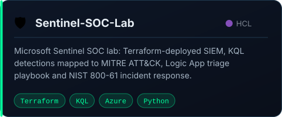
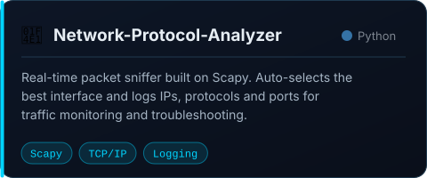
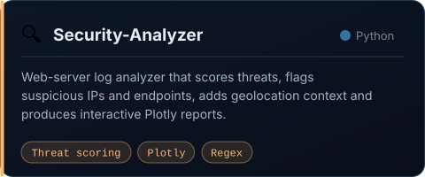
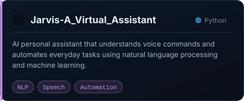

  

  
  
  
  

 

  

## 🛡️ What I do

<table>
  <tr>
    <td width="33%" valign="top">
      <h3>🔎 Detect</h3>
      Writing KQL detection rules mapped to <b>MITRE ATT&amp;CK</b>, tuning SIEM alerts and hunting for threats in log data.
    </td>
    <td width="33%" valign="top">
      <h3>🚨 Respond</h3>
      Working incidents end-to-end with <b>NIST 800-61</b> runbooks and automated triage playbooks.
    </td>
    <td width="33%" valign="top">
      <h3>☁️ Secure the cloud</h3>
      Deploying security tooling on <b>Azure</b> and <b>GCP</b> as code with Terraform, Docker and Python.
    </td>
  </tr>
</table>

## 🧰 Arsenal

   
  

  
  
  
  
  
  
  
  
  
  

## 🚀 Featured projects

<table>
  <tr>
    <td width="50%"></td>
    <td width="50%"></td>
  </tr>
  <tr>
    <td width="50%"></td>
    <td width="50%"></td>
  </tr>
</table>

  
<b>📁 More things I've built</b>

   

| Project | What it is | Stack |
|---|---|---|
| [Hospital-Management-System](https://github.com/nikhildahiya24/Hospital-Management-System) | Desktop app for patients, staff and records | Java |
| [Hotel-Management-System](https://github.com/nikhildahiya24/Hotel-Management-System) | Rooms, bookings and customer management | Java |
| [Helmet](https://github.com/nikhildahiya24/Helmet) | Hardening an Express app with HelmetJS (freeCodeCamp InfoSec) | Node.js |
| [Leetcode-Questions](https://github.com/nikhildahiya24/Leetcode-Questions) | My LeetCode solutions | Java |
| [Spotify_Clone](https://github.com/nikhildahiya24/Spotify_Clone) · [Instagram-clone](https://github.com/nikhildahiya24/Instagram-clone) · [SpaceXClone](https://github.com/nikhildahiya24/SpaceXClone) | Front-end clones | HTML · CSS · JS |
| [Tip-Calculator](https://github.com/nikhildahiya24/Tip-Calculator) · [Birthday-Greet](https://github.com/nikhildahiya24/Birthday-Greet) · [Bigger-Number-Game](https://github.com/nikhildahiya24/Bigger-Number-Game) | Android apps | Kotlin |

## 📊 Stats

  
  

  

---

  <code>&gt; Thanks for stopping by. Let's secure the future together 🔐</code>

